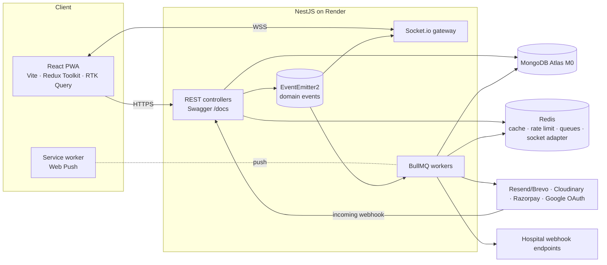
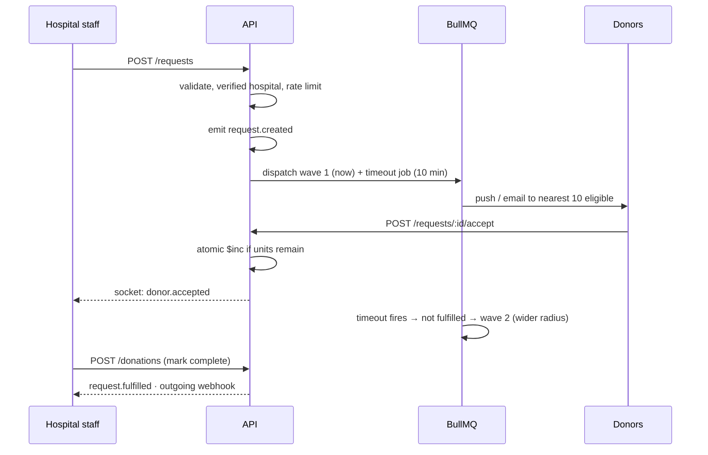

# 02 Architecture

## System

One NestJS process runs HTTP, sockets, and workers on the free tier. Workers are separate providers, so
they can move to their own process later without code changes (`WORKERS_ENABLED` flag).

## Request lifecycle

## Module map (backend)

| Module | Owns |
|---|---|
| auth | JWT access + refresh cookie, Google OAuth, email verification, password reset |
| users | Accounts, roles |
| hospitals, memberships | Tenants, staff membership, verification documents |
| donors | Profile, location, availability, eligibility rules, compatibility |
| requests | BloodRequest CRUD and state machine |
| dispatch | Waves, geo matching, timeout jobs |
| responses | Accept/decline, atomic confirmation |
| donations | Completion records, history |
| chat | Per-request messages, unread counts |
| notifications | Push, email, in-app center, preferences, quiet hours, caps |
| webhooks | Outgoing endpoints, signed deliveries, retries, delivery log |
| payments | Razorpay medical fund, incoming webhook, idempotency |
| analytics | Aggregations for dashboards |
| audit | Sensitive action log |
| health | `/health` liveness + readiness |

Modules talk through exported services and domain events. Notifications, webhooks, sockets, and audit
**listen** to events (`request.created`, `donor.accepted`, `request.fulfilled`…) — the requests module
does not know they exist.

## Frontend shape

`app/` wires store, router, providers. `shared/` is a project-agnostic kit (UI, hooks, http, config).
`features/` hold RedRelay screens. Server state lives in RTK Query; sockets patch its cache.
Details: [04 Folder structure](04-folder-structure.md).

## Deployment

| Piece | Where |
|---|---|
| Frontend | Vercel (static build) |
| API + sockets + workers | Render free web service (Docker) |
| Database | MongoDB Atlas M0 |
| Redis | See [03 Tech stack](03-tech-stack.md) — free-tier caveats matter for BullMQ |
| Errors | Sentry free |
| CI | GitHub Actions |
